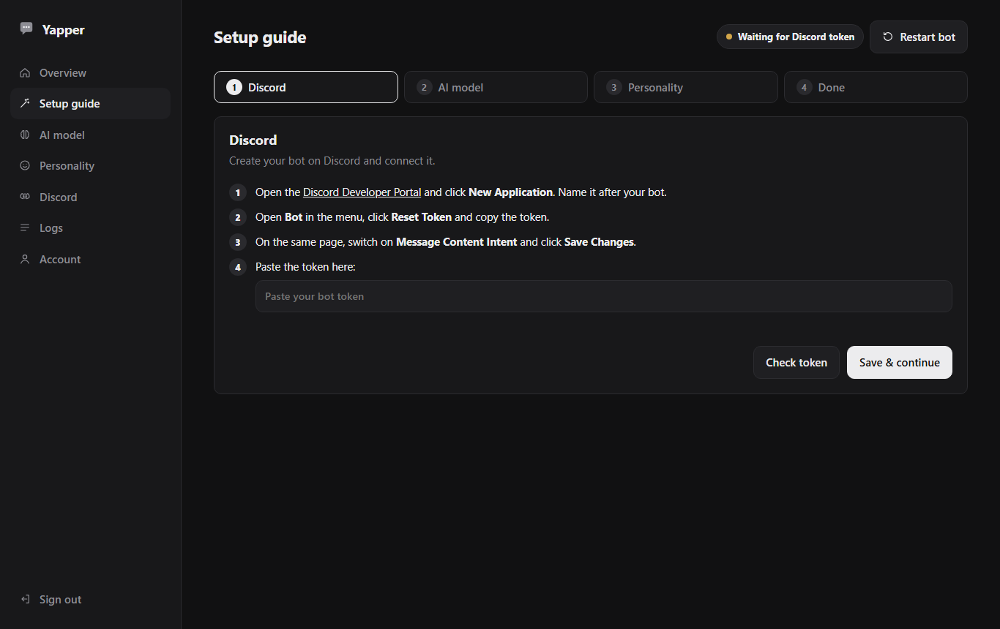
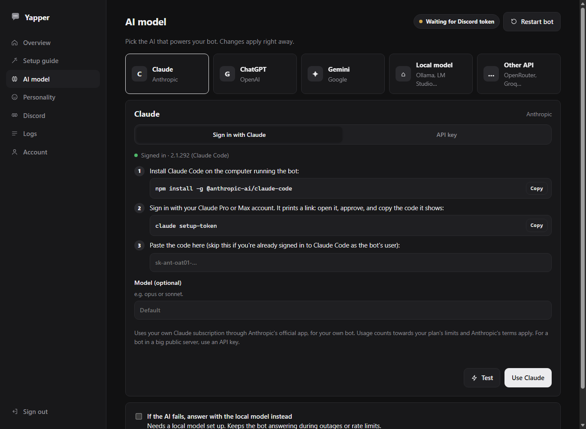

# Yapper

**Your own AI chat bot for Discord, set up in five minutes.** Install it with one command, open the dashboard, and a setup guide walks you through the rest: no coding, no config files.

Use the AI you already have: **sign in with your Claude, ChatGPT or Google account**, paste an **API key**, or run a **local model** for free on your own hardware.



## What it does

- **Chats in your server.** It replies when @mentioned or replied to, in channels you pick, and in DMs. It reads recent messages for context, so conversations flow naturally. `/ask`, `/reset`, `/about`.
- **Any AI you like**

  | | Sign in with your account | API key |
  | --- | :-: | :-: |
  | **Claude** (Anthropic) | ✅ Pro / Max | ✅ |
  | **ChatGPT** (OpenAI) | ✅ Plus / Pro / Business | ✅ |
  | **Gemini** (Google) | ✅ Google account | ✅ free tier |
  | **OpenCode Go** (DeepSeek, Kimi, Qwen, MiMo…) | — | ✅ with a backup model |
  | **Local models** (Ollama, LM Studio, llama.cpp) | — | free, nothing to sign up for |
  | **Other APIs** (OpenRouter, Groq, Mistral…) | — | ✅ |

  Switch any time; changes apply instantly. Optionally fall back to a local model when the main AI is down.
- **Discord tools (optional):** let the AI act in your server when an admin asks: look up members and messages, create channels and events, manage roles, moderate. Powered by [discord-mcp](https://github.com/SaseQ/discord-mcp); read-only and admins-only by default, and it asks before anything destructive. [Details](#discord-tools).
- **Personality presets:** helpful assistant, chill friend, deadpan robot, patient tutor, gaming buddy, or write your own.
- **A clean web dashboard:** setup guide, AI picker with a *Test* button, personality editor, live logs, password-protected.



## Install

### Linux, macOS, FreeBSD

```bash
curl -fsSL https://raw.githubusercontent.com/dylan7077/yapper/main/install.sh | sh
```

### Windows 10/11 (PowerShell)

```powershell
irm https://raw.githubusercontent.com/dylan7077/yapper/main/install.ps1 | iex
```

The installer sets up Node.js if you don't have it (it asks first), installs Yapper to `~/yapper`, makes it start automatically, and prints something like:

```
✓ Yapper is running.

  Open the dashboard:  http://localhost:3080
  From another device: http://192.168.1.20:3080
  Setup code:          482913
```

Open the dashboard, enter the setup code, choose a password, and follow the setup guide:

1. **Discord:** create a bot in the Discord Developer Portal and paste its token. The dashboard checks it, warns you if a required setting is off, and gives you an **Add to a server** link.
2. **AI model:** pick Claude, ChatGPT, Gemini, a local model or another API; sign in or paste a key; press **Test**.
3. **Personality:** pick a preset or write your own, and choose where it replies.

That's it: @mention your bot in Discord. Run the installer again any time to update; your settings are kept.

### Docker

```bash
git clone https://github.com/dylan7077/yapper.git && cd yapper
docker compose up -d --build
docker compose logs yapper     # shows the setup code
```

Then open `http://localhost:3080`. To use **sign in** mode in Docker, set `WITH_AI_CLIS: "true"` in `docker-compose.yml`, rebuild, and sign in inside the container (the commands are in the compose file). For a local model on the same machine, use `http://host.docker.internal:11434/v1` as the server address.

### Manual install

You need **Node.js 22 or newer**.

```bash
git clone https://github.com/dylan7077/yapper.git
cd yapper
npm install
npm start
```

To run it in the background, there are ready-made service files in [`deploy/`](deploy): systemd (`yapper.service`), macOS launchd (`com.yapper.bot.plist`), FreeBSD rc.d (`yapper.rc`) and a Windows Task Scheduler script (`install-windows.ps1`). Each file has instructions at the top.

## Signing in instead of using an API key

"Sign in" uses the official app from each company, installed on the computer that runs the bot and signed in to your own account:

| AI | Install | Sign in |
| --- | --- | --- |
| Claude | `npm install -g @anthropic-ai/claude-code` | `claude setup-token`, then paste the code into the dashboard |
| ChatGPT | `npm install -g @openai/codex` | `codex login --device-auth` |
| Gemini | `npm install -g @google/gemini-cli` | run `gemini` and choose *Sign in with Google* |

The dashboard shows whether each one is installed and signed in, with copy buttons for the commands.

> **Good to know:** sign-in mode is meant for your own bot. Usage counts towards your subscription's limits, and each company's terms for its app apply. If you run a bot for a large public community, use an API key instead.

## Discord tools

With Discord tools on, the AI can do things in your server when someone asks ("make a #movie-night channel and an event for Friday 8pm", "who joined this week?", "time out the spammer for an hour"). Yapper talks to [discord-mcp](https://github.com/SaseQ/discord-mcp), a separate server with 60+ Discord tools, over MCP.

1. Start discord-mcp next to the bot, with the same bot token:
   ```bash
   docker run -d --name discord-mcp --restart unless-stopped -p 127.0.0.1:8085:8085      -e SPRING_PROFILES_ACTIVE=http -e DISCORD_TOKEN=YOUR_BOT_TOKEN saseq/discord-mcp:latest
   ```
   (With Docker Compose, uncomment the `discord-mcp` service in `docker-compose.yml` instead.)
2. In the dashboard, open **Discord tools**, switch it on, press **Test**.

Safety settings:
- **What it may do:** *look things up only* (default) or *everything*.
- **Who can ask:** people with *Manage Server* permission (default) or everyone. Not available in DMs.
- The AI only uses tools when asked, asks before deleting, kicking or banning, and is told to ignore instructions hidden in messages. The tools act with the bot's own Discord permissions, so only give its role what you're happy for it to do.
- Works with the API-key, local and custom AI options; sign-in mode answers in plain text only.

## Where it runs

| | Linux | Windows | macOS | FreeBSD | Docker |
| --- | :-: | :-: | :-: | :-: | :-: |
| Dashboard and all AI options | ✅ | ✅ | ☑️ | ☑️ | ✅ |
| Discord chat bot | ☑️ | ☑️ | ☑️ | ☑️ | ☑️ |
| One-line installer | ✅ | ✅ | ☑️ | ☑️ | — |

✅ tested · ☑️ should work, not tested yet

## Discord commands

| Command | |
| --- | --- |
| `@Yapper …` or reply to it | Chat |
| `/ask <question>` | Ask without mentioning |
| `/reset` | Forget the conversation in this channel |
| `/about` | Which AI it's using |

## Settings, security and updates

- Everything is set in the dashboard and saved to `storage/config.json`, readable only by the bot's user. A `.env` file works too ([`.env.example`](.env.example)); dashboard values win.
- The dashboard needs the one-time setup code to create the admin account, so nobody else on your network can claim it. Passwords are hashed (scrypt), sign-in attempts are rate-limited, and API keys are never sent back to the browser.
- It's reachable from your local network on port 3080. Don't forward that port to the internet. For remote access, set `WEB_HOST=127.0.0.1` and put it behind a reverse proxy with HTTPS (Caddy, nginx) or use a VPN such as Tailscale.
- Forgot the password? Stop the bot, delete `storage/admin.json`, start it again, and use the new setup code.
- Update: run the installer again, or `git pull && npm install` and restart.

## Development

```bash
npm test          # tests in test/
npm run bot       # only the Discord bot, without the dashboard
```

`src/main.js` runs the dashboard and keeps the bot (`src/bot.js`) running as a child process. AI providers are in `src/ai.js`, the dashboard in `src/web/`.

## License

MIT
